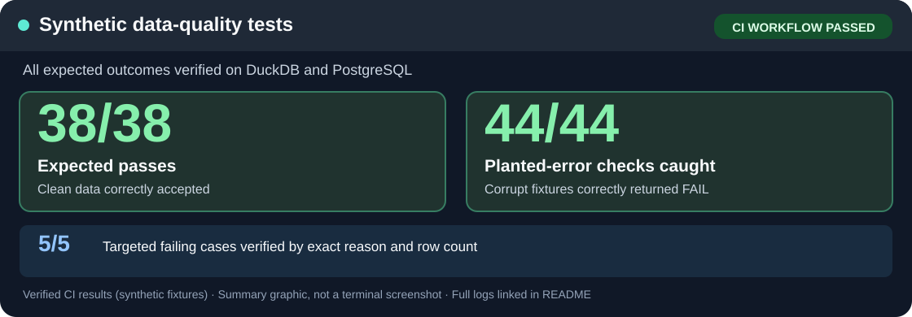

# dbt-honest-data

**Data tests for errors that look like clean data.** A reusable [dbt](https://docs.getdbt.com/) package that catches records silently lost between tables, estimates stored as facts, and claims the evidence doesn't support: mistakes that pass dbt's ordinary `not_null` and `unique` checks.

**Scope:** this is a testing package, not a modeling showcase. Each custom check was written when a data problem turned up in a job-listing pipeline I built: an estimated date that looked exact, a status that guessed “open,” a filter that hid a real pay change. Together they're the checks I'd add to an existing dbt project so those mistakes can't slip through quietly again.

**Built by [Jason Yi](https://github.com/hi-jason)** with AI coding assistance (Claude Code); the design decisions and audit findings are mine · [MIT license](LICENSE)

**Built with:** dbt (SQL and Jinja) · Python · DuckDB · PostgreSQL · GitHub Actions

[](https://github.com/hi-jason/dbt-honest-data/actions/workflows/core-tests.yml)
[](https://github.com/hi-jason/dbt-honest-data/actions/workflows/basic-examples.yml)
[](https://github.com/hi-jason/dbt-honest-data/actions/workflows/advanced-examples.yml)

**Where to start**

- **2 minutes:** this page, down to *Proof*.
- **10 minutes:** the case study, [***When clean data lies***](docs/when-clean-data-lies.md): six problems found in the data, how each was diagnosed, and the check it led to.
- **Reviewing the code:** the [examples](#how-the-checks-attach-to-a-model) show checks on real models, every name in [the checks table](#the-eight-core-checks) links to its macro, and [how the tests are tested](integration_tests/README.md) lists each check's passing and planted-error fixtures and walks through the harness that runs them.

## The problem it came from

I audited 83,965 snapshots from five public job-listing feeds over ten days. The worst errors didn't crash anything or leave a column empty:

| What the audit found | Why it mattered | The check it led to |
| --- | --- | --- |
| [**18,536 inferred posting dates**](docs/when-clean-data-lies.md#1-a-complete-date-column-that-made-estimates-look-exact) | A date worked out from “Posted 3 Days Ago” was stored like a confirmed timestamp | [`provenance_is_paired`](macros/provenance_is_paired.sql): every estimated date carries its precision label |
| [**41.8% of records shown as open**](docs/when-clean-data-lies.md#2-not-closed-was-quietly-converted-into-open) | `is_closed = false` was read as proof a listing was open, when it could also mean “closure unknown” | [`known_cases`](macros/known_cases.sql) and [`claim_requires_evidence`](macros/claim_requires_evidence.sql) guard the status rules; no test alone can prove a listing is open |
| [**A real 17% pay increase hidden**](docs/when-clean-data-lies.md#5-fixing-noisy-change-alerts-accidentally-hid-a-meaningful-pay-rise) | A filter meant to suppress noisy edits threw away a genuine change in how pay was quoted | [`claim_requires_evidence`](macros/claim_requires_evidence.sql): a change marked “material” must have evidence, and evidence must be marked |

These are findings from that audit, not counts of problems the package fixed automatically. The checks guard against each mistake coming back; they don't replace the judgment that found it.

> **Read the full story → [*When clean data lies: what 83,965 job-listing snapshots taught me*](docs/when-clean-data-lies.md)** (about 8 minutes). Six findings, including three not shown above, how each was diagnosed, the decision I made, and what each check can and can't prove.

## What this project shows

- **Audit findings turned into reusable tooling:** 16 generic dbt tests, written as Jinja macros and generalized from the checks a real pipeline needed.
- **Tests that are themselves tested:** every check runs against clean synthetic data, where it must pass, and against data with a planted error, where it must fail. Five must also fail for the exact reason expected. See [how the tests are tested](integration_tests/README.md).
- **Reproducible CI on two databases:** [GitHub Actions](.github/workflows/) runs every suite on DuckDB and PostgreSQL with pinned versions.
- **Judgment about when not to use it:** [the testing playbook](docs/AE_QUALITY_PLAYBOOK.md) says when dbt's built-in tests are enough, and [the decision register](docs/AE_EXCLUSIONS_AND_DECISIONS.md) records the tools and checks I chose not to adopt, and why.

## Proof: clean data passes, planted errors are caught



**CI passes on DuckDB and PostgreSQL.** The 44 failing assertions are *expected detections*: each one is a planted error the package caught, not a broken job. Five of them are also checked row by row against the expected failure label and count, by [`verify_failure_reasons.py`](integration_tests/verify_failure_reasons.py). [See the core CI runs](https://github.com/hi-jason/dbt-honest-data/actions/workflows/core-tests.yml), and [every check with its fixtures](integration_tests/README.md#every-check-and-its-fixtures).

## The eight core checks

| Test | The mistake it catches |
| --- | --- |
| [`provenance_is_paired`](macros/provenance_is_paired.sql) | An estimated date or missing value has no precision or absence explanation |
| [`coverage_claim_holds`](macros/coverage_claim_holds.sql) | A source is labeled “unparseable,” yet some of its records contain parsed values |
| [`claim_requires_evidence`](macros/claim_requires_evidence.sql) | A change is announced without evidence—or evidence exists without the corresponding claim |
| [`bounds_are_a_window`](macros/bounds_are_a_window.sql) | The recorded bounds of an uncertain event contradict each other |
| [`every_row_accounted_for`](macros/every_row_accounted_for.sql) | A transformed dataset drops or invents source identities |
| [`partitions_into`](macros/partitions_into.sql) | Records are lost or duplicated when a dataset is split into outputs |
| [`known_cases`](macros/known_cases.sql) | Reviewed reference examples change or disappear |
| [`grouped_share_in_band`](macros/grouped_share_in_band.sql) | A healthy overall rate conceals an unacceptable result in a subgroup |

The package has **16 generic tests** in all; [`macros/`](macros/) holds every one, each opening with a comment block that explains it. [Each check's fixtures](integration_tests/README.md#every-check-and-its-fixtures) show it passing on clean data and failing on a planted error. The other eight are smaller safeguards: future-dated observations, lifecycle ordering, population coverage, forbidden column names and text, one row per identity, rate bands, and feature switches.

Start with dbt's built-in `not_null`, `unique`, `relationships`, and `accepted_values` checks. Add one of these only when the failure it catches matters to your data.

## How the checks attach to a model

### Don't lose listings when you keep the latest version

A typical model keeps the newest snapshot of each listing:

```sql
-- models/marts/listings_current.sql
with ranked as (
    select
        *,
        row_number() over (
            partition by listing_id order by captured_at desc
        ) as snapshot_rank
    from {{ ref('stg_listing_snapshots') }}
)
select * from ranked
where snapshot_rank = 1
```

Downstream, each listing goes into exactly one status table: open, closed, or unknown. The checks sit on the model in its `schema.yml`:

```yaml
version: 2
models:
  - name: listings_current
    data_tests:
      # Every listing in the snapshots is still here; none invented.
      - honest_data.every_row_accounted_for:
          arguments:
            against: ref('stg_listing_snapshots')
            key: listing_id
      # Every listing lands in exactly one status table.
      - honest_data.partitions_into:
          arguments:
            parts: [ref('listings_open'), ref('listings_closed'), ref('listings_status_unknown')]
            key: listing_id
    columns:
      - name: listing_id
        data_tests: [not_null, unique]
```

`every_row_accounted_for` compares **distinct identities**, so many snapshots per listing in the source is fine. `partitions_into` fails if a listing is in no status table or in two. The “unknown” table matters: it stops “not known to be closed” from being counted as open. Numeric keys are compared as native SQL types, so integer `1` matches decimal `1.0`.

### Don't present an estimate as a fact

A staging model turns “Posted 3 Days Ago” into a date, and labels how exact that date is:

```sql
-- models/staging/stg_listings.sql
select
    listing_id,
    coalesce(
        posted_at_exact,
        {{ dbt.dateadd('day', '-1 * days_ago', 'captured_at') }}
    ) as posted_at,
    case
        when posted_at_exact is not null then 'exact'
        when days_ago is not null then 'day_approximated'
    end as posted_at_precision
from {{ ref('base_listings') }}
```

```yaml
version: 2
models:
  - name: stg_listings
    columns:
      - name: posted_at
        data_tests:
          # A date with no precision label (or a label with no date) fails.
          - honest_data.provenance_is_paired:
              arguments:
                provenance_column: posted_at_precision
                key_column: listing_id
      - name: posted_at_precision
        data_tests:
          - accepted_values:
              arguments:
                values: ['exact', 'day_approximated']
```

If someone later adds a third way to fill `posted_at` and forgets the label, the column still has no nulls, so `not_null` passes, but `provenance_is_paired` fails. A blank label counts as missing. Neither check verifies that the source's date is itself true.

The model SQL is illustrative. CI runs its own synthetic fixtures, not these snippets.

## Install

In the `packages.yml` of a dbt project next to a local checkout of this repository:

```yaml
packages:
  - local: ../dbt-honest-data
```

To install from Git, pin a commit SHA (or a release tag once one is published):

```yaml
packages:
  - git: "https://github.com/hi-jason/dbt-honest-data.git"
    revision: "<reviewed-commit-sha>"
```

From the **consuming project's** directory run `dbt deps`. The core package has no third-party dbt package dependencies.

## Run the tests

With dbt Core and an appropriate database adapter installed in a disposable environment:

```bash
bash integration_tests/run.sh
bash ae_starter/run.sh
bash ae_advanced/run.sh
python3 scripts/check_docs.py
```

The [basic](ae_starter/README.md) and [advanced](ae_advanced/README.md) example projects use invented data. CI runs them independently on DuckDB and PostgreSQL. The [core harness](integration_tests/README.md) rejects skipped, missing, or errored tests as proof of detection; five targeted negative cases additionally require the **correct failure reasons**.

## Limitations

- **What is checked:** These tests enforce configured data rules, not the independent truth of a job listing, financial statement, or external source. In particular, an “open” status needs a trustworthy status definition before tests can enforce it; suppression decisions need a reviewable change-detection policy.
- **Supported environments:** Requires dbt Core 1.10 or later (for the `arguments:` test syntax). The tested combinations are dbt Core 1.12.6 with DuckDB/dbt-duckdb 1.11.1 and PostgreSQL 16/dbt-postgres 1.11.0. `varchar` and other SQL constructs require validation before claiming additional warehouse support.
- **Data scope:** Empty inputs, incompatible key types, real-data scale, and test failure output containing sensitive values need explicit review. Synthetic success is not a privacy or production-performance certification.
- **Coverage:** All 44 negative tests are checked for the required assertion status; five also verify exact failure labels and row counts. Other negative cases are not yet reason-locked.

## Where to go next

1. [**Case study: *When clean data lies***](docs/when-clean-data-lies.md): the six findings and the decisions behind each check.
2. [**Testing playbook**](docs/AE_QUALITY_PLAYBOOK.md): when to use dbt's built-in tests, and when one of these is worth adding.
3. [**Decision register**](docs/AE_EXCLUSIONS_AND_DECISIONS.md): what I chose not to adopt, and what would change my mind.
4. [**How the tests are tested**](integration_tests/README.md): the harness, step by step, and every check's passing and planted-error fixtures.
5. [**Basic**](ae_starter/README.md) and [**advanced**](ae_advanced/README.md) example projects: runnable, with invented data.

Everything else, including the mutation matrix (the kinds of error each check targets), the pattern catalog, adapter notes and changelog, is listed in the [documentation index](docs/README.md).
